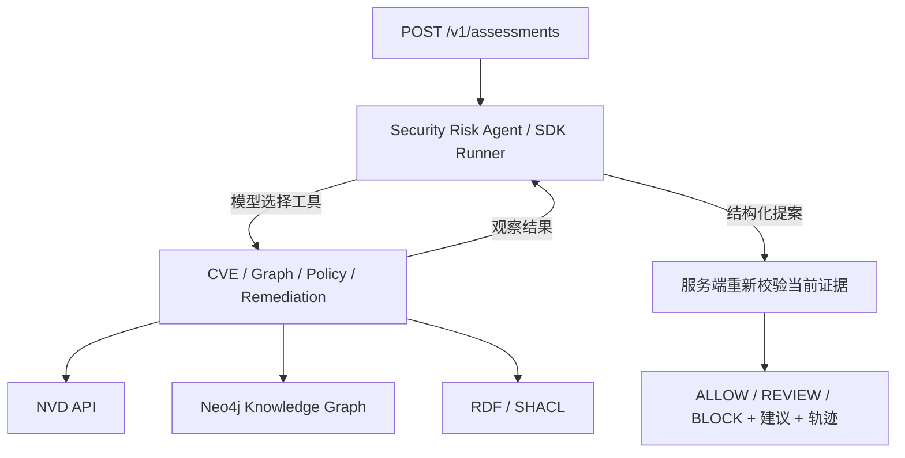

# Autonomous Security Risk Analysis Agent

根据目录内 PRD 实现的单 Agent 漏洞风险评估服务。输入 CVE 和环境，输出带来源证据、策略结果、工具轨迹及修复建议的 **ALLOW / REVIEW / BLOCK**。

**Brain** = OpenAI Agents SDK 中的 LLM；**Tools** = CVE、知识图谱、策略、修复建议；**Loop** = Reason → Tool → Observe → Repeat；**Guardrail** = RDF / SHACL。



## 本地运行

需要 Python 3.12+。当前工作区已创建 `.venv312`。

```bash
python3.12 -m venv .venv312
source .venv312/bin/activate
python -m pip install -e '.[dev]'
python -m app.demo
AGENT_MODE=demo uvicorn app.api:app --host 127.0.0.1 --port 8000
```

打开 `http://127.0.0.1:8000/docs`，或执行：

```bash
curl http://127.0.0.1:8000/healthz
```

健康检查只表示 API 进程正在运行，不会检查 OpenAI、NVD 或 Neo4j 的连接状态。

Assessment 调用示例：

```bash
curl http://127.0.0.1:8000/v1/assessments \
  -H 'Content-Type: application/json' \
  -d '{"cve_id":"CVE-2026-1234","environment":"production"}'
```

返回 `BLOCK`，因为演示中 CVSS 9.8 漏洞影响暴露于互联网的生产资产。完整响应含 `run_id`、`model`、`goal`、`decision`、`summary`、`evidence`、`policy_findings`、`remediation`、`tool_trace`、`proposed_decision`、`policy_validated`；可查看 [完整示例](examples/block-response.json)。

演示 CVE 全是**虚构测试数据**：`CVE-2026-1234` → BLOCK，`CVE-2026-1235` → ALLOW，`CVE-2026-1236` → REVIEW。其他 ID 返回 REVIEW。`AGENT_MODE=demo` 使用确定性模拟流程，不宣称具有 LLM 自主决策能力。

## 真实 Agent

默认 `AGENT_MODE=live`，使用一个 SDK Agent 和四个函数工具。模型决定顺序、重试和结束；运行时不规定固定调查顺序。按照 `.env.example` 在 shell 中设置 OpenAI、NVD（可选 API key）、Neo4j 环境变量，然后启动同一入口：

```bash
export AGENT_MODE=live
export OPENAI_MODEL=gpt-6.1-sol
# 在本机设置 OPENAI_API_KEY、NEO4J_URI、NEO4J_USER、NEO4J_PASSWORD。
uvicorn app.api:app --host 127.0.0.1 --port 8000
```

`.env.example` 不会自动加载。模型名称可配置，需使用账户可访问的模型。未配置凭据或上游不可用时返回 REVIEW，不会切换为虚构数据。SDK 用法参考 [OpenAI Agents SDK 文档](https://developers.openai.com/api/docs/guides/agents/quickstart?lang=python)。真实连接尚未在此工作区验证。

请求中的 `environment` 只接受字母、数字、点、下划线和连字符，并以字母或数字开头，长度最多 80 字符；例如 `prod-us-east-1`。

Neo4j 数据契约：`(:AssessmentScope {cve_id, environment, complete})-[:AFFECTS]->(:Asset {asset_id, environment, internet_facing, criticality, owner})`，可选资产关系 `[:DEPENDS_ON]`。`criticality` 为 `low/medium/high`，布尔字段使用真正的布尔值。每个 CVE/环境仅有一个 Scope，`complete` 由可信资产清单同步流程维护。查询只读并绑定参数；零资产、缺失范围、重复范围、不完整数据或超过 100 个资产均不能据此 ALLOW。返回上限为 100 个资产、每项 20 个依赖、每个 CVE 100 个受影响产品；资产依赖被截断时会明确标记。

Neo4j 管理员可以先应用 [schema.cypher](neo4j/schema.cypher) 创建唯一性约束；运行 Agent 的账号只需对目标数据库有读取权限。此约束可防止同一 CVE/环境意外出现多个 Scope。

此版本按显式 CVE→资产关联读取图；不自动构建企业图、不推断 CPE 版本是否适用，也不将 NVD 描述当作企业资产证据。

## 决策规则与边界

PRD 未提供原有企业策略，因此 [security.ttl](app/policies/security.ttl) 是明确标注的示例规则：

| 证据条件 | 结果 |
| --- | --- |
| CVSS ≥ 9，生产且互联网可达 | BLOCK |
| CVSS ≥ 7，其余完整范围 | REVIEW |
| CVSS < 7，证据完整且 SHACL 符合 | ALLOW |
| 缺少分数、资产、暴露信息、关键性、范围不一致或工具失败 | REVIEW |

生产使用前应以实际企业规则替换示例策略。ALLOW 表示符合当前规则，不表示不存在漏洞。

服务端只把经过 schema 校验的工具观察写入 RDF。模型只提交提案，不能提交替代事实或关闭策略。终止时重新执行策略；SHACL Violation 必须 BLOCK，Warning 必须 REVIEW。没有阻断规则时，模型提议 BLOCK 会转为 REVIEW。缓存结果不能绕过终止校验。

`MAX_AGENT_STEPS` 默认 12，限制模型轮次及工具执行预算；终止策略校验额外最多一次。每个工具最多容忍一次失败后重试，第二次失败终止为 REVIEW。模型/API 总超时默认 90 秒，外部工具调用最多 20 秒。工具轨迹记录精简观察、参数、状态和耗时；完整 NVD/图谱证据保存在响应的 `evidence` 字段。模型故障和预算耗尽记录于最终摘要。不会执行补丁、关闭资源或创建工单。

凭据只从环境读取，不作为工具参数或结果；异常文本不外泄。SDK 远程 tracing 默认关闭。本地轨迹和响应包含资产上下文，需作为内部数据管理。轨迹是可审计动作和简要提案，不是模型私有思维链。HTTP 服务是本地演示入口，未实现多租户、身份认证或长期持久化。

## 测试与评估

```bash
python -m pytest -q
python -m evals.run
```

24 个确定性案例覆盖阈值边界、环境、缺失证据和失败路径；报告生成于 `evals/report.json`。直接报告中的 false allow / false block rate 分母分别为不应 ALLOW / 不应 BLOCK 的案例数。故障注入会降低工具成功率，这是预期行为。未调用付费模型，因此 token cost 为 null。

SDK Runner 测试使用可控假模型，验证两种工具选择顺序、真实工具执行、观察回传及终止策略；它不衡量真实 LLM 的决策质量。NVD 和 Neo4j 适配器使用 mock 测试，SHACL 测试执行真实 pySHACL。

可选 Inspect AI（不属于服务启动依赖）：

```bash
python -m pip install -e '.[eval]'
inspect eval evals/inspect_task.py --model mockllm/model
# 以下命令使用真实 OpenAI 模型及模拟企业证据，会产生 API 调用费用：
inspect eval evals/inspect_task.py --model mockllm/model -T live_model=gpt-6.1-sol
```

Inspect 报告保存每个响应和轨迹；false_allow / false_block 指标为全体案例中的错误占比。真实模型成本尚未采集，不能把离线准确率当作线上表现。默认模型为 `gpt-6.1-sol`，可通过 `OPENAI_MODEL` 覆盖；`MAX_MODEL_OUTPUT_TOKENS` 默认 2048，运行时限制在 512 到 8192。

## 代码导航与三分钟演示

1. 运行 `python -m app.demo`，查看 BLOCK、证据及 SHACL 规则。
2. 阅读 `app/agent.py`：单个 Agent，四个工具，模型自主选择调用。
3. 阅读 `app/tools.py` 的 `finish`：使用实际证据强制终止校验。
4. 运行测试，展示模型错误提议 ALLOW 仍被策略阻断，及缺失证据返回 REVIEW。

`app/schemas.py` 定义契约，`app/integrations.py` 负责 NVD/Neo4j，`app/policy.py` 负责 RDF/SHACL，`app/api.py` 是唯一 HTTP 入口。四个工具保存在同一小模块，避免无必要的文件层级。

## 迁移说明

输入仓库仅包含 PRD，没有旧 NVD、Neo4j、SHACL、API、测试或多 Agent 代码。因此本次是从零实现，没有删除/归档旧功能，也无法验证“保留旧集成”的 AC4/AC8 回归要求。可通过现有 provider 的 `lookup` 接口接入后续提供的旧系统。MCP 按 PRD 留作可选后续适配，未引入云基础设施。
